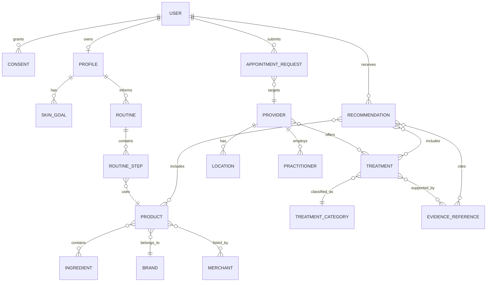

# Canonical data models and API contracts

## Contract rules

Every entity has a stable opaque ID, `created_at`, `updated_at`, an owner/access class, a provenance record, and a status/freshness policy where external data is involved. External IDs are stored separately from internal IDs. User-sensitive records are never returned from public search endpoints.

## Entity inventory

| Entity | Owner | Visibility | Required provenance |
|---|---|---|---|
| `User`, `Profile`, `Preference`, `Consent`, `SkinGoal` | User/account | Owner only | Account/consent version |
| `SkinConcern`, `Ingredient`, `Formulation`, `Product`, `Brand`, `Merchant` | Platform/editorial or partner | Reviewed public subset | Source, observed time, import run |
| `Routine`, `RoutineStep`, `ApplicationInstruction`, `ProgressEntry` | User plus policy version | Owner only; aggregate metrics only | Rules version and user action |
| `TreatmentCategory`, `Procedure`, `Technology`, `Risk`, `EvidenceReference` | Editorial/SME | Reviewed public subset | Source, evidence level, review state |
| `Clinic`, `Practitioner`, `Qualification`, `Location`, `Service`, `Availability` | Provider/editorial | Reviewed public subset | Provider source, verification time, jurisdiction |
| `AppointmentRequest`, `Booking`, `Referral`, `Transaction` | User/platform/partner | Owner or authorized operator | Idempotency key and partner reference |
| `Conversation`, `Recommendation`, `SourceReference`, `Feedback`, `Evaluation` | User/platform/operator | Scoped by sensitivity | Prompt/task/version and source IDs |
| `ContentItem`, `PartnerIntegration`, `Event`, `AuditRecord` | Platform/operator | Policy-scoped | Actor, reason, retention class |

## TypeScript contract sketch

```ts
type Id = string;
type IsoDate = string;
type EvidenceLevel = 'peer_reviewed' | 'regulatory_guidance' | 'manufacturer_data' | 'expert_consensus' | 'anecdotal';
type ReviewStatus = 'draft' | 'in_review' | 'approved' | 'retired';
type CommercialLabel = 'none' | 'sponsored' | 'partner' | 'affiliate';

interface Provenance {
  source_type: 'editorial' | 'partner_feed' | 'regulatory' | 'publication' | 'provider_submitted';
  source_url?: string;
  external_id?: string;
  observed_at: IsoDate;
  imported_at: IsoDate;
  freshness_expires_at?: IsoDate;
  import_run_id: Id;
  reviewed_status: ReviewStatus;
  reviewed_by?: Id;
}

interface IngredientRecord {
  id: Id; key: string; display_name: string; aliases: string[];
  categories: ('antioxidant' | 'retinoid' | 'peptide' | 'humectant' | 'barrier' | 'exfoliant' | 'sunscreen')[ ];
  evidence: EvidenceLevel; rule_version: string; cautions: string[];
  provenance: Provenance;
}

interface ProductRecord {
  id: Id; brand_id: Id; name: string; category: string; ingredients: Id[];
  goals: string[]; price?: { amount_cents: number; currency: string; observed_at: IsoDate };
  availability: 'unknown' | 'in_stock' | 'out_of_stock' | 'discontinued';
  merchant_links: Array<{ merchant_id: Id; url: string; label: CommercialLabel }>;
  eligibility: { status: 'active' | 'draft' | 'retired'; safety_review_version: string };
  provenance: Provenance;
}

interface TreatmentRecord {
  id: Id; category: string; name: string; technology_ids: Id[];
  intended_uses: string[]; benefits: string[]; limitations: string[];
  risks: string[]; recovery: string; suitability_flags: string[];
  requires_professional_assessment: boolean; evidence: EvidenceLevel;
  commercial_label: CommercialLabel; provenance: Provenance;
}

interface ProviderRecord {
  id: Id; kind: 'clinic' | 'dermatology_practice' | 'aesthetic_provider';
  name: string; locations: Id[]; practitioner_ids: Id[]; service_ids: Id[];
  qualifications_summary: string[]; service_area: { country: string; region?: string; radius_km?: number };
  verification: { status: 'unverified' | 'submitted' | 'verified' | 'retired'; checked_at?: IsoDate };
  booking: { mode: 'request' | 'external_link' | 'adapter'; url?: string };
  provenance: Provenance;
}

interface RecommendationResponse {
  profile_version: string; policy_version: string; generated_at: IsoDate;
  items: Array<{ entity_id: Id; kind: 'product' | 'ingredient' | 'treatment' | 'provider'; score?: number;
    reasons: string[]; cautions: string[]; evidence_refs: Id[]; commercial_label: CommercialLabel }>;
  uncertainty: 'low' | 'moderate' | 'high'; professional_assessment_required: boolean;
}
```

## ER diagram



## API contract groups

### Read endpoints

```text
GET  /api/v1/ingredients?query=&category=&concern=
GET  /api/v1/ingredients/:id/compatibility?profile_id=
GET  /api/v1/products?goal=&ingredient=&budget=&merchant=
GET  /api/v1/products/:id/compare?against=
GET  /api/v1/treatments?category=&location=&evidence_level=
GET  /api/v1/treatments/:id
GET  /api/v1/providers?lat=&lng=&radius_km=&service=&verified_only=
GET  /api/v1/providers/:id
GET  /api/v1/routines/:id
```

### User mutations

```text
PUT  /api/v1/profile
POST /api/v1/routines/preview
POST /api/v1/routines/:id/steps/:step_id/confirm
POST /api/v1/recommendations
POST /api/v1/saved-items
POST /api/v1/progress
POST /api/v1/appointment-requests
PUT  /api/v1/consents
POST /api/v1/assistant/conversations/:id/messages
```

### Admin/ingestion mutations

```text
POST /api/v1/admin/ingestion/runs
POST /api/v1/admin/knowledge/:id/review
POST /api/v1/admin/products/:id/review
POST /api/v1/admin/providers/:id/verify
POST /api/v1/admin/evaluations/runs
```

All writes require authenticated ownership or operator authorization, idempotency where external side effects are possible, and an explicit error envelope compatible with the existing `/api/v1` handler.
